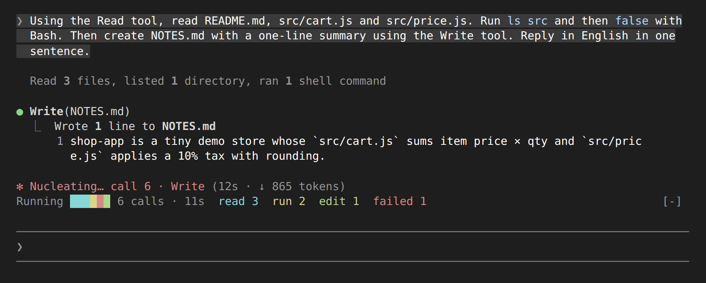
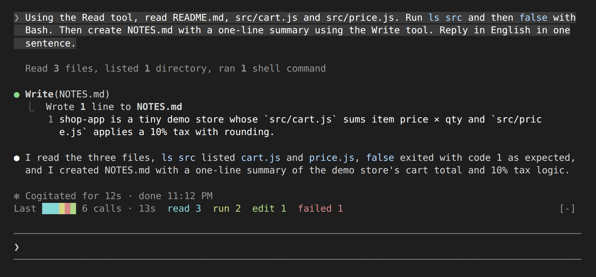

# tool-tape

[日本語](README.md) | [English](README.en.md)

A Claude Code mod that lays out each tool call of the current turn as a colored cell above the prompt. While Claude works you can see at a glance what it did, how many times, where something failed, and how long the turn has taken.



## Reading the band

```
Running ▮▮▮▮▮▮ 6 calls · 9s  read 3  run 2  edit 1  failed 1
```

- **Running / Last**: "Running" while Claude works; once the turn ends it switches to "Last" and keeps that turn's result.
- **Colored cells**: one cell per tool call, oldest on the left. Past 40 cells, the older ones are folded into a count such as `+12` at the left end.
- **6 calls · 9s**: the number of calls and the time since you sent the prompt. It ticks every second while the turn runs.
- **read 3 run 2 …**: calls per kind, in the same color as their cells. A failed call turns its cell red and is also counted under "failed".

| Color | Kind | Tools |
|---|---|---|
| Cyan | read | Read, Grep, Glob, LS, NotebookRead |
| Yellow | run | Bash, BashOutput, KillShell, Monitor |
| Green | edit | Edit, Write, MultiEdit, NotebookEdit |
| Blue | web | WebFetch, WebSearch, Playwright MCP |
| Purple | agent | Agent, Task, SendMessage |
| Gray | other | Everything else (MCP tools and so on) |
| Red | failed | Calls that were denied or returned an error |

The spinner also gets the call number and the latest tool, as in `… call 6 · Write`.



## Requirements

- Claude Code v2.1.287 or later (the release where mods are on by default). Tested in a Linux terminal on v2.1.291.
- The band is drawn in the terminal and in the Code tab of Claude Desktop. The VS Code extension's chat panel and `claude -p` draw nothing; only the counting runs there.

## Install

In a Claude Code session, run:

```
/plugin install tool-tape --marketplace DonMecha/tool-tape
```

Answer `y` to add the marketplace, then pick the default user scope.

To try it without installing, clone this repository and start Claude Code with:

```sh
claude --plugin-dir ./tool-tape
```

## Settings

The label language defaults to `auto`: it reads `LC_ALL`, `LC_MESSAGES` and `LANG` in that order and uses Japanese when the value starts with `ja`, English otherwise. To pin it, pick a value in `/config`, or add this to your user `settings.json`:

```json
{
  "pluginConfigs": {
    "tool-tape@tool-tape": { "options": { "language": "en" } }
  }
}
```

To turn it off, run `claude plugin disable tool-tape@tool-tape`.

## Limitations

- The Claude Code mods API is in early access and may change without notice. A Claude Code update can break the layout or stop the mod from working.
- Only calls made after the mod loaded are counted. It does not read past history and keeps nothing between sessions.
- Neighbouring cells of the same color run together into one bar.
- The mod touches no files, network or processes. The only environment variables it reads are `LC_ALL`, `LC_MESSAGES` and `LANG`, to pick the label language.

## Development

```sh
claude plugin validate .
claude plugin test .
```

## License

[MIT](LICENSE)
